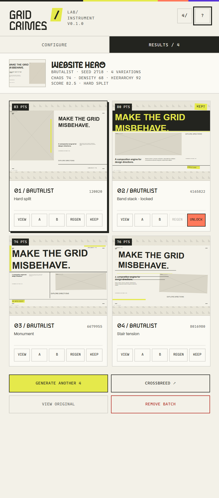

# Grid Crimes

**Break the grid. Keep the craft.**

A procedural composition instrument for Figma Design. Select an existing composition, choose one of six art directions, and generate four new layouts that preserve the actual content as editable layers. Then crossbreed two directions into a third that neither would have produced alone.

**Status:** local development build, `v0.1.0`. Not published to Figma Community. No plugin ID is invented or hardcoded.



---

## What is real in this build

- Six independent direction engines and 24 layout grammars.
- Chaos, density and hierarchy controls that measurably change layout.
- Deterministic seeded generation. The same source, settings and seed produce the same plan.
- Real native Figma output: cloned text, images, vectors and instances placed into new frames. Nothing is rasterised or flattened.
- The original selection is never modified.
- Four distinct variations placed in a 2×2 batch beside the source.
- Crossbreed with genuine design-DNA interpolation, grammar inheritance, compatibility checks and a fresh quality-scored generation pass.
- Versioned metadata on generated frames and batch containers.
- A self-contained UI with no network access and no development server.
- Dense-source handling, missing-font handling, batch cleanup and rollback on failure.

---

## Quick start

Requirements: Node.js 20+ (Node 24 is used here), pnpm 11+, and the Figma desktop app.

```bash
cd plugins/grid-crimes
pnpm install
pnpm run build
```

Then in Figma desktop:

1. Choose **Plugins → Development → Import plugin from manifest…**
2. Select `plugins/grid-crimes/manifest.json`.
3. Run **GRID CRIMES/** from the Development menu.
4. Select a frame, group, or several sibling layers. If nothing is selected, press **Try with sample**.
5. Choose a direction and press **GENERATE 4 VARIATIONS ↗**.

The built files are:

```
dist/code.js     plugin main thread
dist/ui.html     fully inlined interface
manifest.json    Figma manifest (points at dist/)
```

### Local plugin ID

`manifest.json` deliberately omits `id`. Figma assigns a local development identity when the manifest is imported. If your Figma build requires an explicit ID for the import step, create a blank development plugin once (**Plugins → Development → New plugin…**), copy the `id` Figma writes into that generated manifest, and add that same ID to this manifest. That ID is a local registration only.

To publish, create/register the plugin through Figma's Community flow, copy the assigned `id` into the manifest, then submit for review. See [RELEASE.md](./RELEASE.md). Never use an invented ID.

---

## Using it

### Supported selections

- A frame containing 2–30 meaningful direct children.
- A group containing multiple elements.
- Several selected sibling layers.
- A single text or shape layer, with a single-focal warning.
- Nested groups, images, text, shapes and instances as atomic content blocks.
- Auto-layout modules and component instances are scaled as modules, not detached or converted.

Unsupported or risky inputs are explained in the panel rather than silently guessed. Hidden layers are skipped. Root-level instances are treated as one atomic module. Selections above 30 blocks are reduced to the 30 largest with a warning.

### Roles

The plugin infers headline, subhead, body, visual, action, label, module and decoration from text size, layer type, name, position, area and hierarchy. These are heuristics; the **Correct the roles** section lets you override up to six major blocks before generation.

### Output

- Every variation is its own editable frame inside a batch container.
- Frames are named `GRID CRIMES / <DIRECTION> / 001`.
- The batch is placed to the right of the source, avoiding existing page content.
- Real PNG thumbnails are exported from the generated frames for the results view.
- Batch removal deletes only tracked generated nodes. User-added content in the container is preserved.

### Crossbreed

Each variation stores its preset, seed, grammar and DNA. Selecting two compatible parents and moving the inheritance slider creates a new family through the normal planning and scoring pipeline.

The parent picker can use the current batch or two generated frames selected on the canvas. Incompatible source structures are rejected with an explanation. The metadata survives closing and reopening the plugin.

---

## The six directions

| # | Direction | What changes |
|---|---|---|
| A | **Brutalist** | Monumental type, hard divisions, exposed rules, awkward pressure |
| B | **Swiss Editorial** | Asymmetric column grids, editorial scale, precise white space |
| C | **Radical Minimal** | Extreme negative space, one focal gesture, quiet support |
| D | **Maximalist** | Layered colour and geometry with a protected focal hierarchy |
| E | **Anti-grid** | Coherent offsets, broken columns, controlled rotation |
| F | **Controlled chaos** | Hybrid grammars, spatial fracture, anchor fields and collisions |

Each direction has four distinct grammars. Four variations use four different grammars when the content supports them.

---

## Architecture

```
src/
  engine/                 pure TypeScript, no Figma API
    analyze.ts            role inference + snapshot normalization
    geometry.ts           rect math, splits, collision helpers
    compose.ts            placement context, typography estimation, support zones
    planner.ts            candidate search, fallback layouts, dense mode
    grammars/             24 grammars across six directions
    scoring/              containment, collision, contrast, hierarchy, diversity
    crossbreed/           DNA interpolation and grammar inheritance
  main/
    analysis.ts           selection → snapshot, sample composition
    builder.ts            clone/apply plan → native Figma nodes
    placement.ts          2×2 batch geometry and free-space placement
    code.ts               controller, protocol, persistence, lifecycle
  ui/                     vanilla TypeScript interface, bundled HTML
  shared/                 types, presets, validation, metadata, colour math
tests/                    engine, crossbreed, protocol, placement, mock adapter
tools/                    build, preview, Playwright QA
assets/                   licensed fonts, icon, cover
```

The engine never imports the Figma API. It consumes a normalized snapshot and returns a `LayoutPlan` that both the plugin and the browser preview can render. This is why the layout logic is unit-testable and why the generated composition is not an ad-hoc loop over node coordinates.

### Generation pipeline

```
selection
  → normalized semantic blocks
  → role inference + user overrides
  → direction grammar
  → candidate plans (bounded seeded search)
  → hard-constraint validation + quality score
  → accepted plan
  → native Figma frame
```

The plugin caps candidate attempts, computes plans before mutating the canvas, and removes the whole batch container if a build fails.

### Determinism

All engine randomness comes from a seeded Mulberry32 generator. There is no `Math.random()` in layout generation or crossbreed. Plan metadata records the effective seed, settings, grammar and DNA.

### Metadata

Plugin data keys:

- `gridcrimes.meta` — versioned per-variation record (preset, seed, settings, grammar, DNA, source fingerprint, batch ids, revision, lock/keep).
- `gridcrimes.batch` — batch record on the container (variations, settings, aux node ids, parent info). Thumbnails are stripped before persistence.
- `gridcrimes.role` — role marker on cloned content children, used for recovery after reopening.

Figma client storage holds only the last batch reference, batch counter and last settings. No document content is copied into plugin data.

---

## Testing

```bash
pnpm run typecheck
pnpm run test
pnpm run qa
pnpm run build
```

Current results on this machine:

- TypeScript: passing.
- Engine / adapter suite: **35 tests passing**.
- Browser UI QA (Playwright, Chromium): **9/9 cases passing**, including light/dark, 340/440/680 px widths, reduced motion, keyboard navigation and axe serious/critical checks.
- Gallery / cover / icon rendering: passing.
- Native Figma manual validation: **pending** — this repository contains no Figma test environment.

The tests cover all six presets across eight fixtures, deterministic output, diversity, all aspect ratios, long headlines, dense compositions, role overrides, crossbreed inheritance and reproducibility, parameter validation, metadata round-trips, placement, protocol validation, mock selection parsing and missing-font degradation.

### Figma manual QA checklist

Load the development plugin in a scratch Figma file and verify:

1. A frame with text, an image fill, a vector and an instance generates four frames beside the source.
2. Text characters and formatting survive; mixed-font text is not flattened or substituted.
3. A missing font produces a warning and leaves affected type formatting untouched.
4. Image fills crop correctly when resized; no image is re-encoded.
5. An instance remains an instance and its overrides survive.
6. An auto-layout card collection remains internally laid out after uniform scaling.
7. The source is unchanged after generation, regeneration and batch removal.
8. The 2×2 batch does not overlap the source or another batch.
9. Batch removal deletes only generated frames/labels; a user-added layer in the container remains.
10. Undo restores the document after generation and removal.
11. Reopening the plugin restores the last batch and thumbnails.
12. Selecting two generated frames from the same source enables Crossbreed.
13. Crossbreeding with a different source explains the incompatibility instead of producing output.
14. A locked/kept variation cannot be regenerated until unlocked.

Record screenshots and actual results in the release notes before claiming native QA. A dated summary of automated and browser results is in [TEST_RESULTS.md](./TEST_RESULTS.md).

---

## Known limitations

- Role detection is heuristic; correct it before judging a direction.
- Missing fonts are preserved, not replaced. Typography may remain larger/smaller than the new composition intends.
- Instance internals are atomic; the plugin scales the instance rather than editing internal layers.
- Blocks with complex constraints or unusual node types may keep their original size with a warning.
- Compositions above 30 blocks are reduced, and above 18 use the dense editorial index layout.
- Very large image fills are preserved rather than re-encoded or uploaded.
- Crossbreed requires a shared source fingerprint. Two frames built from different source structures are rejected.
- Native Figma rendering fidelity has not been verified in this environment.

---

## Privacy

No network requests. No uploads. No analytics. No accounts. The plugin reads the current selection and writes generated nodes, plugin data and local Figma client-storage settings. See [PRIVACY.md](./PRIVACY.md).

## Licensing

Plugin code is part of the MIT-licensed LAB/ repository. Fonts are licensed under the SIL Open Font License and are included with their license files in `assets/fonts/`.

- Gulax by Morgan Gilbert / Velvetyne Type Foundry.
- Apfel Grotezk by Luigi Gorlero / Collletttivo.

